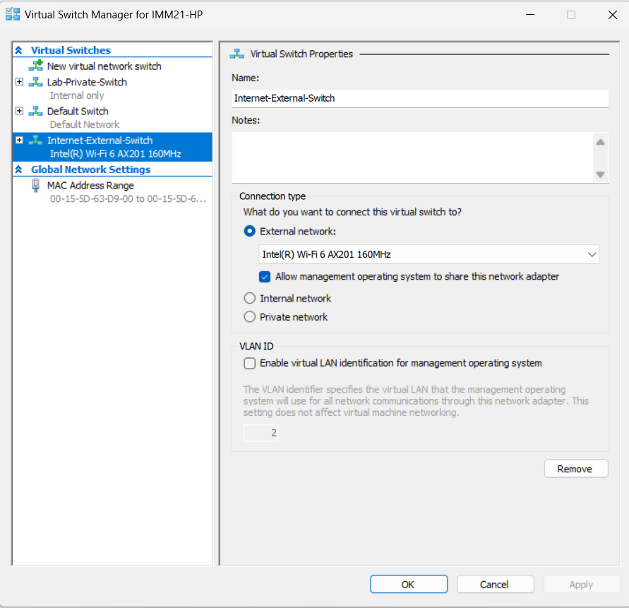
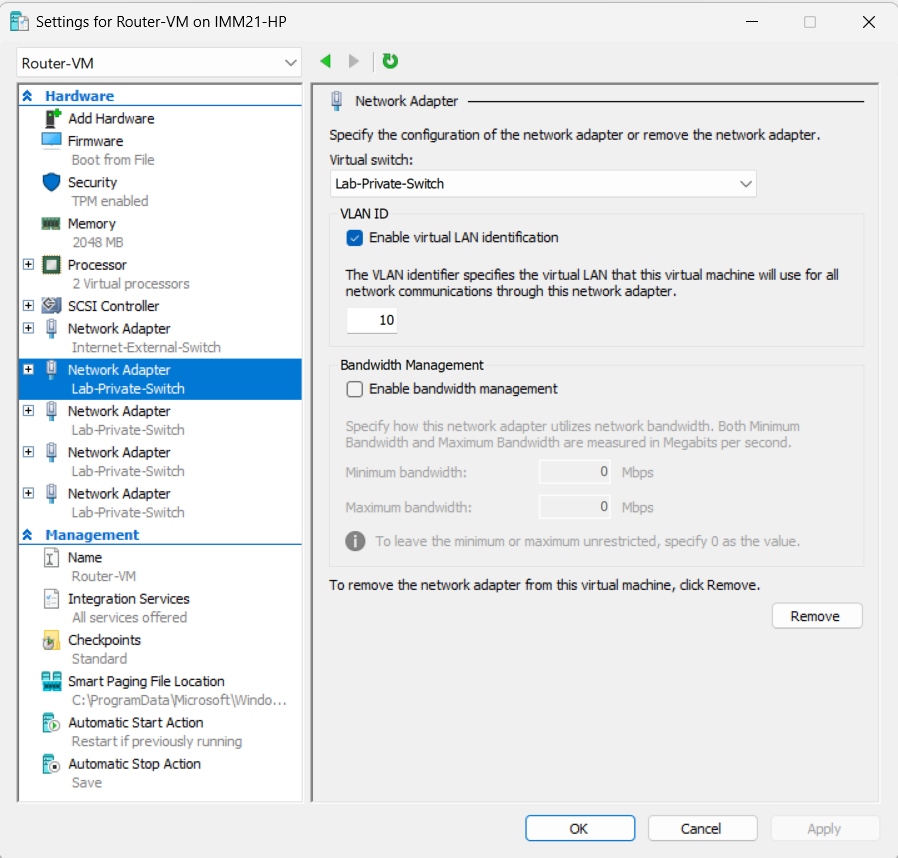
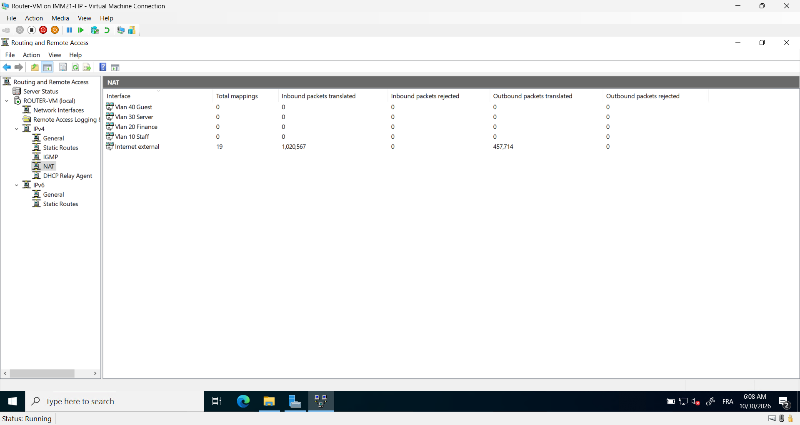

# Multi-Subnet Corporate Network Architecture Lab (Hyper-V)
## Project Overview
This project demonstrates the design and implementation of an isolated, secure enterprise network lab using **Microsoft Hyper-V**. A single physical `/24` private network network (`192.168.1.0/24`) is logically segmented into **4 distinct subnets (/26)** to optimize traffic, improve security boundaries, and restrict unauthorized access.

The core infrastructure features a **Dual-Homed Windows Server Router**, centralized **Active Directory Domain Services (AD DS)**, cross-subnet **DHCP Relay**, and stringent **Firewall Access Control Lists (ACLs)** to isolate untrusted zones.

---

## Network Architecture & Design

### Logical Subnet Breakdown (/26)
* **Subnet Mask:** `255.255.255.192`
* **Private Address Space:** `192.168.1.0/24`

| Department / Subnet | IP Range | Gateway IP | Assigned VLAN ID | Purpose |
| :--- | :--- | :--- | :--- | :--- |
| **Staff Network** | `192.168.1.1 - .62` | `192.168.1.1` | **VLAN 10** | Employee clients and workflows |
| **Finance Network** | `192.168.1.65 - .126` | `192.168.1.65` | **VLAN 20** | Sensitive payroll & corporate endpoints |
| **Server Network** | `192.168.1.129 - .190`| `192.168.1.129`| **VLAN 30** | Domain Controllers, DHCP, File Servers |
| **Guest Wi-Fi** | `192.168.1.193 - .254`| `192.168.1.193`| **VLAN 40** | Untrusted public/visitor traffic |

---

## Lab Implementation Steps

### Phase 1: Hyper-V Virtual Switch Infrastructure
To replicate enterprise switching, we use a single internal virtual switch paired with 802.1Q VLAN tagging, and a secondary external switch assigned strictly to our Edge Router for secure internet transit via NAT.

1. **Corporate-V-Switch:** Set up as an **Internal** virtual switch.
2. **Internet-External-Switch:** Set up as an **External** virtual switch bridged to the host system's physical NIC.

---

### Phase 2: Edge Router VM (Windows Server RRAS)
The Router VM remains a standalone workgroup machine acting as a Multi-VLAN Default Gateway and NAT engine. It features **5 virtual network adapters** mapped directly to our switches.

#### Interface Configurations:
* **VLAN10_Staff:** Static `192.168.1.1` (VLAN ID 10)
* **VLAN20_Finance:** Static `192.168.1.65` (VLAN ID 20)
* **VLAN30_Server:** Static `192.168.1.129` (VLAN ID 30)
* **VLAN40_Guest:** Static `192.168.1.193` (VLAN ID 40)
* **WAN_Internet:** DHCP (Connected directly to `Internet-External-Switch`)

#### NAT & Routing Configuration:
Routing and Remote Access Services (RRAS) are deployed on the router VM to bridge internal client requests to the WAN adapter via Network Address Translation.

---

### Phase 3: Domain Controller Setup (DC01)
**DC01** sits securely inside **VLAN 30** with a single adapter. It manages Active Directory, DNS Forwarding, and centralized DHCP scope distribution.

* **Static IP Address:** `192.168.1.130`
* **Subnet Mask:** `255.255.255.192`
* **Default Gateway:** `192.168.1.129`
* **DNS Resolution:** Local loopback (`127.0.0.1`) configured with public DNS forwarders (`8.8.8.8`) to handle out-of-network requests safely.

#### DHCP Scopes Configuration
4 distinct scopes are engineered inside the DHCP Manager matching our design.

> **[PLACE SCREENSHOT HERE: DHCP Manager Console expanded to show all 4 active scopes]**
> *Filename recommendation: `images/04-dhcp-scopes.png`*

---

### Phase 4: Cross-Subnet DHCP Relay (IP Helper)
Because broadcast frames do not cross VLAN networks natively, a **DHCP Relay Agent** is activated on the Router VM inside the RRAS console.

1. The relay is configured to target DC01 (`192.168.1.130`).
2. The agent is bound to interfaces: **VLAN10**, **VLAN20**, and **VLAN40**.
3. When a client boots, the router intercepts the broadcast, injects the corresponding gateway IP (GiADDR), and relays a unicast packet to DC01.

> **[PLACE SCREENSHOT HERE: Router RRAS showing DHCP Relay Agent properties and bound interfaces]**
> *Filename recommendation: `images/05-dhcp-relay.png`*

---

### Phase 5: Domain Services & Secure File Server Joining
An enterprise File Server and client workstations are introduced into the environment. 

1. VMs are designated to their respective VLAN IDs inside Hyper-V settings.
2. DNS properties are inherited via DHCP, allowing client endpoints to resolve the Active Directory domain root.
3. Computer objects successfully register within the Active Directory schema across the router.

> **[PLACE SCREENSHOT HERE: Active Directory Users and Computers (ADUC) showing joined Client and File Server objects]**
> *Filename recommendation: `images/06-aduc-joined.png`*

#### Group Policy Drive Mapping
A Group Policy Object (`GPO_Map_Finance_Drive`) is linked to deploy a secure SMB network share (`\\FileServer\FinanceData`) targeting specific department users automatically upon authentication.

> **[PLACE SCREENSHOT HERE: Group Policy Management Editor showing the configured Drive Map preference item]**
> *Filename recommendation: `images/07-gpo-drive-map.png`*

---

### Phase 6: Firewall Access Control & Boundary Security
To prevent potential lateral threat movements, an active Inbound Filter rule is applied directly on the Router's **VLAN40_Guest** interface.

* **Source Address Pattern:** `192.168.1.192 / 255.255.255.192`
* **Destination Address Pattern:** `192.168.1.64 / 255.255.255.192`
* **Action:** **DROP** all matching packets.

> **[PLACE SCREENSHOT HERE: RRAS Inbound Filters panel on the Guest interface displaying the drop rule]**
> *Filename recommendation: `images/08-firewall-rule.png`*

---

## Verification & Lab Diagnostics

### 1. Verification of DHCP Scope Distribution
Booting a client inside the Staff segment (`VLAN 10`) dynamically returns an address matching the initial IP planning phase:

> **[PLACE SCREENSHOT HERE: Client command prompt showing successful 'ipconfig /all' output from the Staff subnet]**
> *Filename recommendation: `images/09-client-ipconfig.png`*

### 2. Network Isolation Verification
Simulating an adversarial switch to the Guest zone (`VLAN 40`) results in immediate connection degradation when trying to touch corporate assets, confirming the functionality of the edge ACL filter rules:

* **Ping to External Web (`google.com`):** **SUCCESSFUL** (via NAT)
* **Ping to Internal Server (`192.168.1.66`):** **TIMED OUT / DROPPED** (via Inbound ACL Rule)

> **[PLACE SCREENSHOT HERE: Split terminal prompt on client showing a successful internet ping next to a blocked internal server ping]**
> *Filename recommendation: `images/10-isolation-test.png`*
